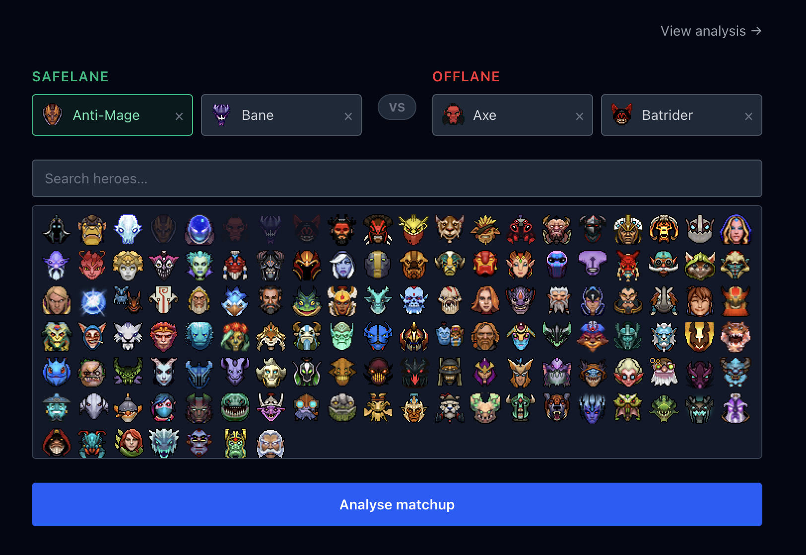

# Safer Lane

Dota 2 safe-lane (2v2) matchup analyser. Pick four heroes - two per team - and get a predicted lane winner, confidence level, recommended combos, and strategic advice powered by the Claude API and real-time Stratz win-rate data.

> Work in progress. See [next steps](#next-steps).

<div style="display: flex; justify-content: center;">
    
</div>

## What it does

1. Pick two heroes for each team using the hero picker (search by name, see portrait icons)
2. Submit - the app queries Stratz for live Divine/Immortal lane matchup win rates and ally synergy scores, then passes that data to Claude alongside each hero's abilities
3. Claude returns a structured analysis: predicted winner, confidence, combo names and descriptions, strategic advice for each team, and key timing notes
4. The result is validated against a Zod schema server-side before it reaches the client


## Stack

- **Next.js** (App Router, TypeScript)
- **Tailwind CSS** - dark theme
- **Anthropic Claude API** - `claude-opus-4-6`, structured JSON output
- **Stratz GraphQL API** - real-time lane matchup win rates and ally synergy (Divine/Immortal bracket)
- **Zod** - schema validation of Claude's response
- **Vitest** - unit tests

## How the AI part works

### Prompt design

The prompt gives Claude three things: each hero's ability names, per-matchup win rates from Stratz (e.g. "Juggernaut vs Crystal Maiden: 54.2% win rate"), and ally synergy scores. It then asks for a JSON object with a fixed schema. No free-form prose - just the structure the front end needs.

```
You are a Dota 2 expert analyst. Analyse this safe-lane 2v2 matchup.

Team A:
- Juggernaut: Blade Fury, Healing Ward, Blade Dance, Omnislash
- Crystal Maiden: Crystal Nova, Frostbite, Arcane Aura, Freezing Field

Statistical data (Divine/Immortal bracket):
Matchup win rates:
  Juggernaut vs Tidehunter: 51.3% win rate
  ...

Return a JSON object with exactly this structure: { ... }
Return only the JSON object with no markdown, code blocks, or other text.
```

### Validation

Claude's response is parsed and run through a Zod schema before being returned to the client. If the JSON is malformed or missing a required field, the API route returns a 502 with a diagnostic message rather than silently passing bad data through.

```ts
const result = LaneAnalysisSchema.safeParse(json);
if (!result.success) {
  return NextResponse.json({ error: "Claude response did not match expected schema", details: result.error }, { status: 502 });
}
return NextResponse.json(result.data);
```

### Mock mode

Set `MOCK_CLAUDE=true` in your `.env` to skip the real API call and return a fixture response. Useful for UI work without spending credits.

## Running locally

```bash
git clone https://github.com/amarriott/safer-lane
cd safer-lane
cp .env.example .env     # fill in your API keys
npm install
npm run dev              # starts at http://localhost:3000
```

You need:
- **Anthropic API key** - [console.anthropic.com](https://console.anthropic.com)
- **Stratz API token** - [stratz.com/api](https://stratz.com/api)

Or set `MOCK_CLAUDE=true` to run without any keys.

## Next steps

- [ ] Confidence field weighted by match count (low-data matchups flagged as uncertain)
- [ ] Response caching - identical hero combinations always produce the same analysis
- [ ] Deploy to Vercel
- [ ] Streaming for lower perceived latency on the analysis response

